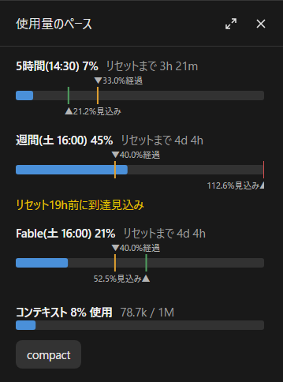

# usage-pace

[English](README.md)

Claude Code のプランの使用量(5時間・週間、Max の Fable のみの週間などモデル別の週間)を、ペースつきのメーターで表示する mod。



## 表示
4つの要素があり、それぞれ表示を切り替えられる。

**使用率のペース(`pace`、パネル)**
- 使用率(整数)と、リセットまでの残り時間
- 名前の横にリセットの時刻(手元の時刻):`5時間(14:30) 7%`、`週間(土 9:00) 45%`(`clock`、最初は on)
- メーターの上の `▼xx.x%経過`:窓の時間のうち経過した割合(等倍で使った場合の位置)
- メーターの下の `▲xx.x%見込み`:今のペースで使い続けた場合の、リセット時の使用率(100% を超える時は右端)
- 100% を超える見込みの時は「リセット xxh(5時間の方は xxm)前に到達見込み」
- 文字は印の左右のうち、空いている側に出る

**モデル別の週間(`model`、パネルと1行、最初は on)**
- Max の Fable のみの上限など、1つのモデルだけの週間の上限を、ほかと同じメーターで出す:`Fable(水 12:00) 21%`
- 入力欄の下の1行では `[F]`(モデル名の頭文字)
- この窓は Claude Code が mod に渡さないので、mod が使用量の窓口(`https://api.anthropic.com/api/oauth/usage`)に自分で問い合わせる。資格情報は Claude Code が持ったまま付け、mod には見えない。問い合わせるのはチャットの開始時と返答の後で、5分に1回まで、全チャットで共有する。claude.ai でログインしていない時(API キー・Bedrock・Vertex・ゲートウェイ)は問い合わせず、ゲージも出ない。`/usage-pace model off` で問い合わせも止まる

**コンテキスト(`context`、パネル)**
- `コンテキスト 42% 使用  84.2k / 200k` とメーター
- 50% から黄色、70% からオレンジ、85% から赤
- その下の `compact` ボタンで `/compact` と同じ要約をする(返答の途中なら、終わってから)

**入力欄の下の1行(`line`)**
- `[S] 32% 2h55m e: 76.8% , [W] 34% 5d19h e: 200.9% (-84h) , [F] 21% 15h e: 22.1% , [C] 42%`
- S は5時間、W は週間、F は Fable のみの週間、C はコンテキスト。e は今のペースでのリセット時の見込み、括弧はリセットの何時間(5時間の方は何分)前に 100% に届く見込みか
- `/usage-pace line tiny` で詰めた形になる:`[S]32%,2h55m,e:76.8%[W]34%,5d19h,e:200.9%(-84h)[C]42%`(「(前回)」は出さない)。`line on` で元に戻る

値は Claude の返答が来た時に更新される(Claude Code が受け取る値をそのまま使う。自分から問い合わせるのはモデル別の週間だけ(上を参照))。経過の割合だけは1分ごとに進む。

新しいチャットでは、返答が来るまで、どれかのチャットが最後に受け取った使用率を「前回の値」として出す。リセット時刻を過ぎた窓は出さない。コンテキストはチャットごとの値なので、返答が来てから出る。

## 言語
日本語と英語。Claude Code の言語設定(`language`)に合わせ、設定が無ければ OS の言語に合わせる。日本語以外は英語になる。

## 使い方
- `/usage-pace`:パネルの開閉
- `/usage-pace <要素> [on|off]`:要素の表示の切り替え。on/off を省くと反転する
  - 要素:`pace`(使用率のペース)、`context`(コンテキスト)、`line`(入力欄の下の1行)、`clock`(パネルのリセットの時刻)、`model`(モデル別の週間)、`all`(全部)
  - `line` には `tiny` も使える(詰めた1行)
  - 例:`/usage-pace line off`、`/usage-pace all on`
- `/usage-pace status`:今の設定

設定は全チャット共通で、次に開くチャットにも効く。`pace` と `context` を両方 off にするとパネルは開かない。

## インストール
ターミナルの Claude Code で:

```
/plugin install usage-pace --marketplace sand-jp/usage-pace
```

デスクトップアプリでは、入力欄の横の + → Plugins → Add marketplace に `sand-jp/usage-pace` → Add plugin。

## ライセンス
0BSD。自由に参照、改変、改善、再配布してよい。著作権表示を残す必要も無い。

## AI の利用について
この mod は、AI(Claude Code)を使って作られた。コードと文書の大半は AI が書き、作者が確認し調整した。
